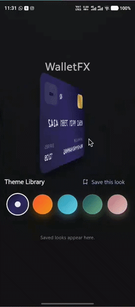
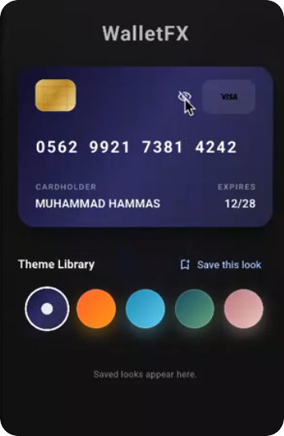
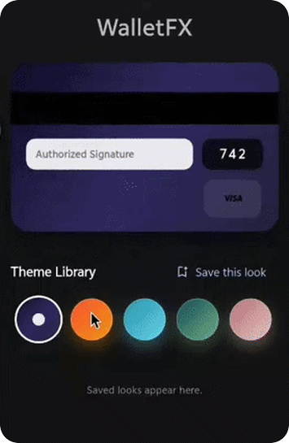
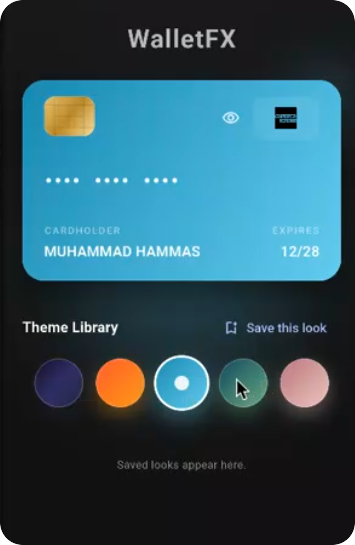
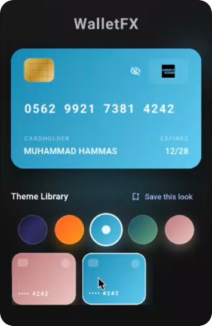

<p align="center">
  
</p>

<p align="center">
  <a href="https://github.com/HammasT1/WalletFX/releases/latest"></a>
  <a href="https://github.com/HammasT1/WalletFX/actions/workflows/release-apk.yml"></a>
  <a href="https://github.com/HammasT1/WalletFX/stargazers"></a>
</p>

<p align="center">
  
  
  
  
  
  
</p>

<p align="center">
  <b>
    <a href="#-demo">Demo</a> &nbsp;·&nbsp;
    <a href="#-download">Download</a> &nbsp;·&nbsp;
    <a href="#-features">Features</a> &nbsp;·&nbsp;
    <a href="#-gestures">Gestures</a> &nbsp;·&nbsp;
    <a href="#-animation-breakdown">Animations</a> &nbsp;·&nbsp;
    <a href="#-theme-library">Themes</a> &nbsp;·&nbsp;
    <a href="#-getting-started">Getting Started</a>
  </b>
</p>

<p align="center">
  
</p>



## 💡 About

**WalletFX** is a Flutter app built around one thing: a credit card that feels good to touch. The card flips in 3D, tilts under your finger, catches a sweep of light, and reveals its digits one flip at a time, all on a dark interface whose ambient glow follows the theme you pick.

It is a UI and motion showcase. The card details are placeholder data. The only thing the app stores is your theme and saved looks, kept on the device; nothing is sent anywhere.

**At a glance**

- 🔄 &nbsp;A 3D flip with real perspective and a touch-driven tilt
- 🎨 &nbsp;Five gradient themes with a matching background glow
- 🔖 &nbsp;A row of saved looks that animates in and out, and is still there next launch
- 🧩 &nbsp;Two package dependencies: `flutter_svg` and `shared_preferences`
- 📲 &nbsp;A ready-made APK on the [Releases](https://github.com/HammasT1/WalletFX/releases/latest) page

<br clear="right" />

## 🎬 Demo

<table align="center">
  <tr>
    <td align="center"></td>
    <td align="center"></td>
    <td align="center"></td>
    <td align="center"></td>
  </tr>
  <tr>
    <td align="center"><b>Front</b><br /><sub>Number revealed</sub></td>
    <td align="center"><b>Back</b><br /><sub>CVV revealed</sub></td>
    <td align="center"><b>Themed</b><br /><sub>Ocean Blue, number masked</sub></td>
    <td align="center"><b>Saved looks</b><br /><sub>Tap to apply, long-press to remove</sub></td>
  </tr>
</table>

## 📲 Download

<p align="center">
  <a href="https://github.com/HammasT1/WalletFX/releases/latest"></a>
</p>

Want to try the app without building it? Grab the ready-made Android APK:

1. Open the [latest release](https://github.com/HammasT1/WalletFX/releases/latest).
2. Under **Assets**, download `WalletFX-vX.Y.Z.apk`.
3. Open the file on your Android phone and allow installs from that source when asked.

> [!NOTE]
> Every APK there is built automatically by [GitHub Actions](.github/workflows/release-apk.yml) from the tagged source code.

## ✨ Features

<table>
  <tr>
    <td width="50%" valign="top">
      <h3>🔄 &nbsp;3D card flip</h3>
      Tap the card to rotate it around the Y axis with real perspective and a slight overshoot.
    </td>
    <td width="50%" valign="top">
      <h3>🖐️ &nbsp;Touch tilt</h3>
      Drag across the card and it leans toward your finger, then settles back when you let go.
    </td>
  </tr>
  <tr>
    <td width="50%" valign="top">
      <h3>✨ &nbsp;Shine sweep</h3>
      A band of light crosses the card on entry and every time the theme changes.
    </td>
    <td width="50%" valign="top">
      <h3>👁️ &nbsp;Number peek</h3>
      The eye button reveals the masked digits with a staggered flip; the last four stay visible.
    </td>
  </tr>
  <tr>
    <td width="50%" valign="top">
      <h3>🔐 &nbsp;CVV reveal</h3>
      Tap the CVV box on the back to show or hide the code.
    </td>
    <td width="50%" valign="top">
      <h3>🎨 &nbsp;Theme library</h3>
      Five gradient themes, each paired with a card network logo.
    </td>
  </tr>
  <tr>
    <td width="50%" valign="top">
      <h3>🔖 &nbsp;Save this look</h3>
      Bookmark themes into an animated row, tap one to apply it, long-press to remove it. Each theme is saved once.
    </td>
    <td width="50%" valign="top">
      <h3>🌌 &nbsp;Ambient glow</h3>
      The blurred background glow cross-fades to match the selected theme.
    </td>
  </tr>
  <tr>
    <td width="50%" valign="top">
      <h3>📳 &nbsp;Haptic feedback</h3>
      Light haptics on theme selection, saving, removal, and copying.
    </td>
    <td width="50%" valign="top">
      <h3>📐 &nbsp;Responsive layout</h3>
      The card keeps the standard 1.586 aspect ratio and caps its width on large screens.
    </td>
  </tr>
  <tr>
    <td width="50%" valign="top">
      <h3>💾 &nbsp;Remembers your looks</h3>
      The selected theme and the saved row are restored the next time the app opens.
    </td>
    <td width="50%" valign="top">
      <h3>📋 &nbsp;Copy card number</h3>
      Long-press the card to copy the full number to the clipboard, with a short confirmation.
    </td>
  </tr>
</table>

## 👆 Gestures

| Gesture | Where | Result |
| :--- | :--- | :--- |
| **Tap** | Card | Flip between front and back |
| **Drag** | Card | Tilt in 3D, following your finger |
| **Long-press** | Card | Copy the card number to the clipboard |
| **Tap** | Eye icon (front) | Peek or hide the full card number |
| **Tap** | CVV box (back) | Show or hide the CVV |
| **Tap** | Theme swatch | Switch the card gradient and background glow |
| **Tap** | *Save this look* | Add the current theme to your saved row |
| **Tap** | Saved thumbnail | Apply that look again |
| **Long-press** | Saved thumbnail | Remove it from the row |

## 🎥 Animation Breakdown

Every motion in the app is hand-tuned. The card itself is driven by three explicit `AnimationController`s merged into a single `AnimatedBuilder`; the rest uses Flutter's implicit animations.

| Animation | Duration | Curve | Technique |
| :--- | :---: | :--- | :--- |
| Card entry (fade, lift, scale) | 900 ms | `easeOutCubic` | `AnimationController` + `Transform` |
| Shine sweep | 10–85% of entry | `easeInOut` | `Interval` on the entry controller |
| Card flip | 700 ms | `easeInOutBack` | `Matrix4` with perspective, `rotateY` 0 → π |
| Touch tilt | follows the finger | — | `rotateX` / `rotateY` from the pan position |
| Number peek | 760 ms | `easeInOutCubic`, staggered per digit | Per-digit 3D flip |
| Card gradient change | 500 ms | `easeOutCubic` / `easeInCubic` | `AnimatedSwitcher` |
| Ambient glow change | 520 ms | `easeOutCubic` / `easeInCubic` | `AnimatedSwitcher` + `BackdropFilter` blur |
| Swatch selection | 180–220 ms | `easeOut` | `AnimatedScale`, `AnimatedContainer`, `AnimatedOpacity` |
| CVV and eye icon swap | 220 ms | `easeOutCubic` / `easeInCubic` | `ScaleTransition` + `FadeTransition` |
| Saved look insert | list default | `easeOutBack` | `AnimatedList` with size, fade and scale |
| Saved look removal | 280 ms | linear | `AnimatedList.removeItem` |

<details>
<summary><b>How the 3D flip works</b></summary>
<br />

Both faces of the card sit in the same `Stack`. Each gets a `Matrix4` with a perspective entry, the current tilt, and a Y rotation. The back face is offset by π, so it is always the mirror of the front, and the face that is pointing away from the viewer is hidden at the halfway mark.

```dart
final baseMatrix = Matrix4.identity()
  ..setEntry(3, 2, 0.0015)      // perspective
  ..rotateX(_tiltOffset.dy)     // touch tilt
  ..rotateY(_tiltOffset.dx);

final frontMatrix = baseMatrix.clone()..rotateY(flipValue);
final backMatrix  = baseMatrix.clone()..rotateY(flipValue + math.pi);
```

</details>

## 🎨 Theme Library

<p align="center">
  
</p>

| Theme | Gradient | Network |
| :--- | :--- | :--- |
| **Midnight Purple** | `#0F0C29` → `#302B63` → `#24243E` | Visa |
| **Sunset Orange** | `#FF512F` → `#F09819` | Mastercard |
| **Ocean Blue** | `#2193B0` → `#6DD5ED` | American Express |
| **Emerald Green** | `#134E5E` → `#71B280` | Discover |
| **Rose Gold** | `#B76E79` → `#E8C4C4` | Visa |

Adding a theme is one entry in [lib/models/card_gradient_theme.dart](lib/models/card_gradient_theme.dart):

```dart
CardGradientTheme(
  name: 'Arctic Mint',
  colors: [Color(0xFF00B09B), Color(0xFF96C93D)],
  assetPath: 'assets/visa.svg',
),
```

## 🧱 Tech Stack

| Layer | Choice |
| :--- | :--- |
| **Framework** | Flutter, Material 3, dark theme |
| **Language** | Dart `^3.9.2` |
| **State** | `StatefulWidget` + `setState`, no external state library |
| **Animation** | Explicit `AnimationController`s, `Matrix4` transforms, implicit animated widgets, `AnimatedList` |
| **Drawing** | `CustomPainter` for the card surface and chip |
| **Persistence** | [`shared_preferences`](https://pub.dev/packages/shared_preferences) for the selected theme and saved looks |
| **Assets** | SVG network logos rendered with [`flutter_svg`](https://pub.dev/packages/flutter_svg) |

## 📂 Project Structure

```text
lib/
├── main.dart                        # App shell, theme library, saved looks, ambient glow
├── models/
│   └── card_gradient_theme.dart     # Theme model and the five built-in gradients
├── utils/
│   └── card_number_formatter.dart   # Groups card digits in blocks of four
└── widgets/
    ├── credit_card_widget.dart      # Card faces, flip, tilt, peek, shine, chip
    ├── card_painter.dart            # CustomPainter for the card surface
    └── gradient_swatch_picker.dart  # Animated theme swatches

assets/                              # Network logos (SVG), app icon
docs/                                # README artwork, screenshots, demo GIF
.github/workflows/release-apk.yml    # Builds and publishes the APK on every version tag
```

## 🚀 Getting Started

**Prerequisites:** the [Flutter SDK](https://docs.flutter.dev/get-started/install), version 3.35.4 (Dart 3.9.2). This is the version the project and its release workflow are built with.

```bash
# 1. Clone the repository
git clone https://github.com/HammasT1/WalletFX.git

# 2. Move into the project
cd WalletFX

# 3. Install dependencies
flutter pub get

# 4. Run on a connected device or emulator
flutter run
```

Run on a specific platform:

```bash
flutter run -d chrome     # Web
flutter run -d windows    # Windows desktop
```

Run the widget tests:

```bash
flutter test
```

Build a release APK:

```bash
flutter build apk --release
```

## 📦 Releasing a New Version

Pushing a version tag is all it takes. The [Release APK](.github/workflows/release-apk.yml) workflow builds the APK, creates a GitHub Release for the tag, and attaches `WalletFX-vX.Y.Z.apk` to it.

```bash
# 1. Make sure everything you want in the release is committed and pushed
git push origin main

# 2. Create an annotated tag (the version after "v" becomes the app version)
git tag -a v1.0.0 -m "WalletFX v1.0.0"

# 3. Push the tag to GitHub, which starts the build
git push origin v1.0.0
```

A few minutes later the APK appears on the [Releases](https://github.com/HammasT1/WalletFX/releases) page. You can follow the build in the [Actions](https://github.com/HammasT1/WalletFX/actions) tab.

> [!IMPORTANT]
> Tags must start with `v` (`v1.0.0`, `v1.1.0`, `v2.0.0-beta.1`) to trigger the workflow.

<details>
<summary><b>Redoing a release</b></summary>
<br />

Delete the tag, then create and push it again:

```bash
git tag -d v1.0.0                  # delete the tag locally
git push origin --delete v1.0.0    # delete the tag on GitHub
```

</details>

<details>
<summary><b>Building without releasing</b></summary>
<br />

The workflow can also be started by hand from the Actions tab with **Run workflow**. A manual run does not create a release; the APK is saved as a downloadable artifact on that run.

</details>

<p align="center">
  
</p>

<p align="center">
  Designed and built by <a href="https://github.com/HammasT1"><b>Muhammad Hammas Rasheed</b></a>
</p>

<p align="center">
  If WalletFX was useful or fun to play with, a ⭐ on the repo is appreciated.
</p>

<p align="center">
  <a href="#top"><sub>Back to top ↑</sub></a>
</p>
