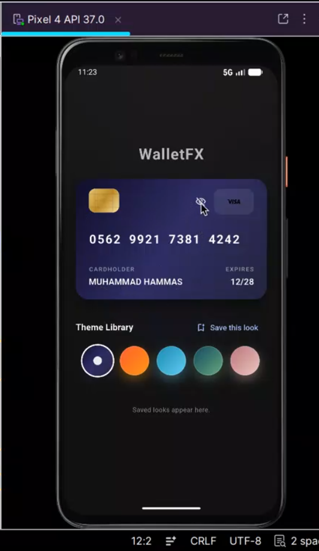
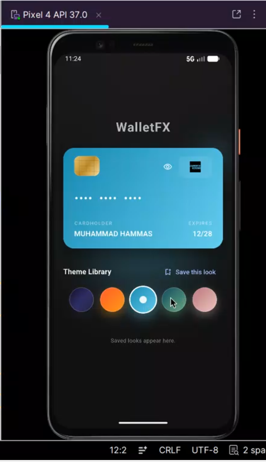
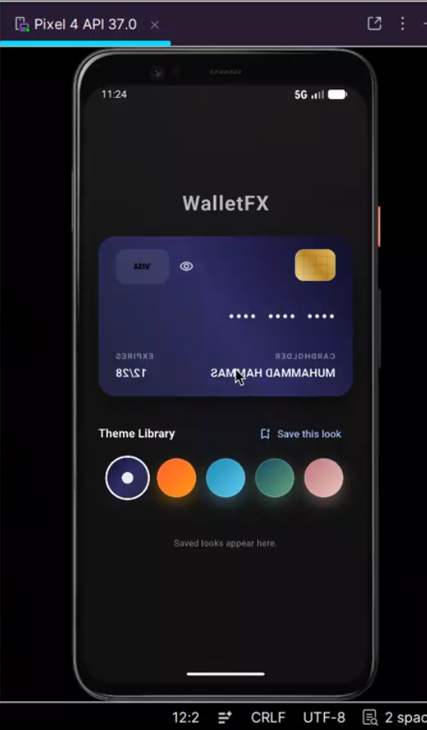
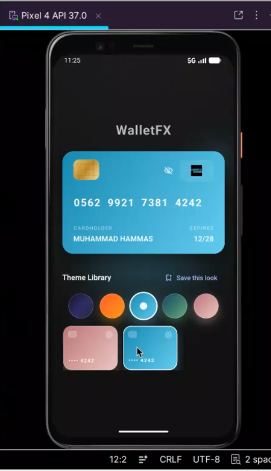

# 💳 WalletFX — Animated Credit Card App (Flutter)

<p align="center">
  
  
  
  
</p>

---

> ### 🎬 App Animation GIF
> 

> ### 📸 App Screenshots
> | Front View 1 | Front View 2 | Back View | Save Feature |
> | :---: | :---: | :---: | :---: |
> |  |  |  |  |

---

## 💡 Project Description

**WalletFX** is a specialized, beautifully engineered Flutter mobile application built to showcase smooth, interactive credit card animations[cite: 2]. It features fluid card rotation dynamics, custom visual gradients, secure number formatting, and an immersive UI/UX designed to simulate modern digital wallet experiences.

---

## 🛠️ Concepts, State Management & Technologies Used

* **Flutter & Dart:** Core cross-platform mobile app framework and programming language[cite: 2].
* **State Management:** Employs a clean, modular approach utilizing Flutter's built-in UI state control and explicit animation controllers to manage dynamic card rotations, swatch selections, and the interactive save-feature views.
* **Advanced Animations:** Implements explicit controllers and matrix transformations to handle seamless 3D-like card flipping and rotation interactions.
* **Custom Painters (`Card Painter`):** Utilized for drawing precise card patterns, chip layouts, network logos, and dynamic visual gradients.
* **Modularity:** Clean separation of concerns with structured models (`card_gradient_theme.dart`), formatters (`card_number_formatter.dart`), and custom widgets.
* **Asset Integration:** Tailored SVG assets and styling configurations for major card networks (Visa, Mastercard, American Express, Discover).

---

## 🚀 How to Run the Project

Ensure you have the [Flutter SDK](https://docs.flutter.dev/get-started/install) installed on your system. Run the following commands in your terminal to set up and run WalletFX locally:

```bash
# 1. Clone the repository
git clone [https://github.com/HammasT1/WalletFX.git](https://github.com/HammasT1/WalletFX.git)

# 2. Navigate to the project directory
cd WalletFX-main

# 3. Install project dependencies
flutter pub get

# 4. Launch the application
flutter run
